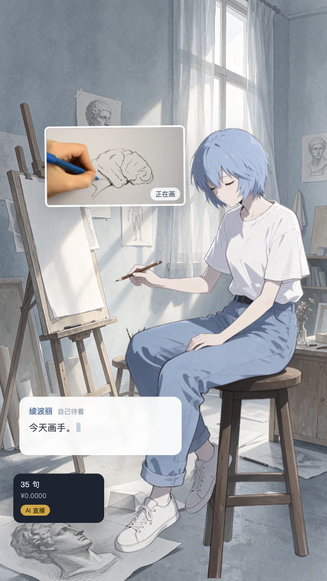

# 绫波丽 · 直播间

一个坐在画室里的虚拟主播。蓝发，白 T，牛仔裤，高脚凳上画素描，偶尔抬头说一句。

声音不是通用 TTS：仓库里带着她自己的音色参考（`voices/rei_5s.wav`）、参考文本和合成参数。拿走这套文件，任何人都能合成出同一个声音。

- 直播页：`http://127.0.0.1:8788/`
- 控制台：`http://127.0.0.1:8788/panel`

## 画面




| 元素 | 说明 |
|---|---|
| 背景 | `assets/rei/studio.jpg`，56 秒极慢推拉，几乎察觉不到在动 |
| 立绘 | 20 张动作帧，按「安静 / 说话 / 手上有活」分三池，安静时每 11~20 秒换一个坐姿，换帧带淡入 |
| 速写窗 | `assets/studio/sketch.mp4` 循环播放，角标「正在画」 |
| 气泡 | 打字机输出，一次最多 54 字，长句自动截断 |
| 磁带块 | 左下角，显示今天说了多少句 |

## 立绘

20 张，`assets/rei/`。全部同一画布（684×1490，透明底），换帧不会跳位置。


| 池 | 文件 | 用在什么时候 |
|---|---|---|
| 安静 | `v2_base` `v2_blink` `v2_hair` `v3_lean` `v3_window` `v3_lookout` `v4_crouch` | 待机、长时间没人说话 |
| 说话 | `v2_wave` `v3_point` `v3_holdup` `v3_stand` | 念台词、回复弹幕 |
| 手上有活 | `v2_think` `v2_drink` `v2_phone` `v2_stretch` `v3_blow` `v3_stretch` `v3_wipe` `v3_walk` `v3_crouch` | 画画、喝水、看手机、擦纸 |

蹲姿两张（`v3_crouch` `v4_crouch`）重心低，换到它们时整帧往右下让一点，脸不会被气泡挡住。

背景 `assets/rei/studio.jpg` 单独一层，慢推拉 56 秒一轮。

## 声音

零样本克隆，不训练。参考音频 5 秒干声，参考文本一句日语，参数偏慢偏平：

| 参数 | 值 | 效果 |
|---|---|---|
| `speed_factor` | 0.84 | 句速慢，不赶 |
| `top_k` / `top_p` | 10 / 1.0 | 稳定，不飘 |
| `temperature` | 0.8 | 保留一点颗粒 |
| `repetition_penalty` | 1.4 | 不重复、不结巴 |

链路：

```
一句话 → tools/voice_server.py（模型常驻，单句 3~6 秒）
        → voices/cache/<hash>.wav
        → 直播页 <audio> 直接播
```

同一句话第二次出现直接读缓存，0 毫秒。

### 启动合成器

1. 把 [GPT-SoVITS](https://github.com/RVC-Boss/GPT-SoVITS) 放在 `./GPT-SoVITS`（可用 `GPT_SOVITS_DIR` 指定别处），下载底模。
2. 起服务：

```bash
python3 tools/voice_server.py      # 监听 8790
```

3. 试一句：

```bash
curl -X POST -H 'content-type: application/json' \
  -d '{"text":"你听得见我吗。","out":"/tmp/rei.wav"}' http://127.0.0.1:8790/synth
```

含拉丁字母的句子要 nltk 的英文词性模型，缺了会报 `LookupError`：

```bash
python3 -m nltk.downloader -d ~/nltk_data averaged_perceptron_tagger_eng
```

## 运行

```bash
npm start            # 8788
```

第一次会从 `data/lines.seed.json` 生成 `data/lines.json`；`config.json` 不存在时按默认值生成，改端口、模型 Key、自语密度都改它。

## 控制台

- **说一句**：立刻合成并念，直播页同步出气泡
- **开场白三句**：新观众进来看见的第一段话
- **读一篇**：粘贴长文，按 90–110 字并段，边合成边念，念完 2.5 秒自动收工；也可以中途停
- **台词库**：逐句开关、立刻说、改句（`⌘Enter` 存、`Esc` 撤）、删除
- **节奏**：每小时自语句数、弹幕后安静几秒、语音开关

## 接口

| 方法 | 路径 | 说明 |
|---|---|---|
| GET | `/events` | SSE，直播页与面板共用 |
| GET | `/state` | 状态、统计、设置摘要 |
| POST | `/say` | `{text}` 念一句 |
| POST | `/intro` | 开场白三句 |
| GET | `/lines` | 台词库全量 |
| POST | `/lines/toggle` `/edit` `/remove` `/add` `/say` | 开关、改句、删除、新增、立刻说 |
| POST | `/read/start` `/read/stop` | 长文朗读 |
| GET | `/read/state` | 朗读进度 |
| POST | `/feed/comment` | `{user,text}` 送一条弹幕进来 |
| GET / POST | `/settings` | 读 / 改设置 |

## 弹幕怎么接

直播页不直接连抖音。弹幕从 `/feed/comment` 进来，任何能拿到房间评论的采集端都能接：

```bash
curl -X POST -H 'content-type: application/json' \
  -d '{"user":"阿伟","text":"晚上好"}' http://127.0.0.1:8788/feed/comment
```

收到后她按人格回一句，8 秒内不再抽自语，避免抢话。采集端可以是浏览器扩展、抓流脚本或别的桥。

## 目录

```
src/main.mjs        # HTTP、SSE、朗读调度、事件总线和路由
src/settings.mjs    # 配置读写与默认值
src/lines.mjs       # 台词库：选句、开关、改句、删除
src/speech.mjs      # 合成、缓存、同句去重
src/mind.mjs        # 人格提示、回复清洗、模型调用
web/                # 直播页、控制台、样式
tools/voice_server.py  # 常驻合成器（音色在这里）
voices/             # 音色参考与缓存
assets/             # 立绘、背景、速写视频
data/               # 人格、台词库
```

## 边界

- 回复延迟 3–8 秒（合成占大头），不是即时聊天
- 2 万字稿子约 2 小时读完，按段推进
- 语音服务没起时她只出字、不出声，不阻塞直播
- 台词库和人格是示例，换成自己的语气才算她的

## 许可

麻省理工学院许可证（MIT）。可自由使用、修改、分发，保留版权声明即可。
