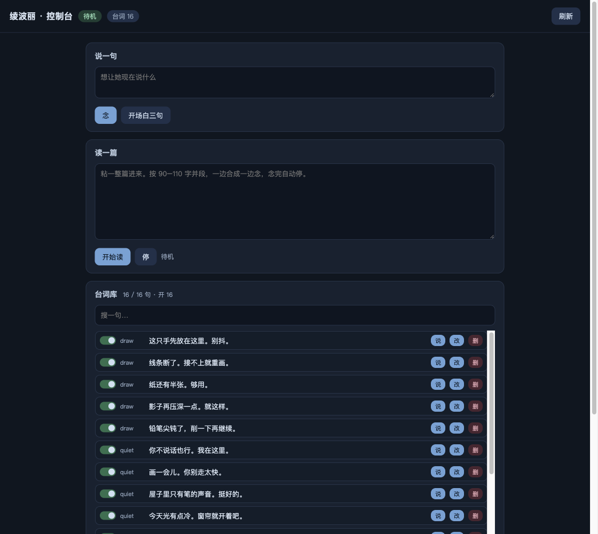

# 绫波丽 · 直播间


她坐在画室的高脚凳上画素描，蓝头发，桌上有纸和铅笔。没人说话的时候，她隔半分钟自言自语一句；有人发弹幕，她抬头接一句。跑起来是一个 Node 进程加一个本地语音 worker，浏览器窗口打开就能当直播画面。


做这事的起因很简单：通用 TTS 一开口，所有虚拟角色听起来都是同一个人。所以她的音色参考、参考文本、合成参数都放在仓库里，谁拿去跑，出来的都是这个音色。

## 先听

《纸》《屋子》《边缘》三段手记，用她自己的声音念，九分三十六秒，没有配乐没有旁白。

▶ **[voices/preview-read.mp3](https://github.com/qqwuhua001/ayanami-rei-live/blob/main/voices/preview-read.mp3?raw=true)**

原文在 `voices/preview-read.txt`。换稿子重做一条：

```bash
python3 tools/render_read.py voices/preview-read.txt voices/preview-read.mp3 \
  --worker http://127.0.0.1:8790 --ffmpeg /path/to/ffmpeg
```

脚本按 90~110 字并段，句间 0.3 秒，段落之间 1.1 秒，小标题后 1.6 秒，逐段合成后拼接。

## 跑起来

要 Node 20 以上。只想出字不想出声，装好 Node 就够了：

```bash
npm start
```

开 <http://127.0.0.1:8788/>，看见画室和她就成了。控制台在 <http://127.0.0.1:8788/panel>。

第一次启动会从 `data/lines.seed.json` 生成 `data/lines.json`（16 句示例）；没有 `config.json` 就按默认值建一个，端口、模型 Key、自语密度都在里头。删掉它就恢复默认。

要她真出声，还得有语音这边：

1. 把 [GPT-SoVITS](https://github.com/RVC-Boss/GPT-SoVITS) 放在 `./GPT-SoVITS`（放别处就用 `GPT_SOVITS_DIR` 指过去），底模按它自己的说明下载。
2. 起常驻合成器，监听 8790：

   ```bash
   python3 tools/voice_server.py
   ```

3. 试一句，看整条链路通不通：

   ```bash
   curl -X POST -H 'content-type: application/json' \
     -d '{"text":"你听得见我吗。","out":"/tmp/rei.wav"}' http://127.0.0.1:8790/synth
   ```

`/tmp/rei.wav` 能正常出声，就可以回直播页了。语音服务没起的时候她只出字幕不出声，页面不会卡住。

句子里夹拉丁字母时会走 nltk 的英文词性标注，缺模型报 `LookupError`，补一下：

```bash
python3 -m nltk.downloader -d ~/nltk_data averaged_perceptron_tagger_eng
```

## 画面

背景是 `assets/rei/studio.jpg`，56 秒一轮极慢的推拉，站远了看半天也未必发现它在动。左边速写窗放 `assets/studio/sketch.mp4`，循环，角标写「正在画」。台词走打字机，一次最多 54 字，长了截断加省略号。左下角那块像旧磁带标签，记今天说了多少句。

立绘 20 张，全在 `assets/rei/`，同一块画布（684×1490，透明底），换帧不跳位置。按用处分三池：

- **安静**：`v2_base` `v2_blink` `v2_hair` `v3_lean` `v3_window` `v3_lookout` `v4_crouch`，待机时每 11~20 秒换一个坐姿，换帧带 0.32 秒淡入
- **说话**：`v2_wave` `v3_point` `v3_holdup` `v3_stand`，念台词、回弹幕用
- **手上有活**：`v2_think` `v2_drink` `v2_phone` `v2_stretch` `v3_blow` `v3_stretch` `v3_wipe` `v3_walk` `v3_crouch`，喝水、看手机、擦纸的时候用


两张蹲姿（`v3_crouch` `v4_crouch`）重心低，换过去时整帧往右下让 34 像素，不然脸被气泡压住。

控制台长这样：



## 声音

零样本克隆，不训练。参考音频是 5 秒干声 `voices/rei_5s.wav`，参考文本一句日语，参数调得偏慢偏平：

| 参数 | 值 | 为什么 |
|---|---|---|
| `speed_factor` | 0.84 | 她说话慢，赶起来就不像了 |
| `top_k` / `top_p` | 10 / 1.0 | 收窄采样，别飘 |
| `temperature` | 0.8 | 留一点颗粒，不要播音腔 |
| `repetition_penalty` | 1.4 | 防复读、防结巴 |

一句话进去，模型在 `tools/voice_server.py` 里常驻，单句 3~6 秒出 wav，落在 `voices/cache/<hash>.wav`，页面直接播。同一句第二次出现读缓存，不再合成。

这里有个坑踩过：模型吐的样本是 int16，当 ±1 浮点写盘会整句削成方波，听着像破喇叭。`voice_server.py` 现在按 dtype 缩放并显式写 `PCM_16`，换机器跑之前先看一眼 `voices/cache/` 里老文件，峰值顶到 1.0 的全清掉。

## 控制台能改什么

五块，都在 `/panel`：

- **说一句**：立刻合成、立刻念，直播页同时出气泡
- **开场白三句**：新观众进来先看到的那段
- **读一篇**：贴长文进去，按 90~110 字并段边合成边念，念完 2.5 秒收工，中途能停，每 8 段停 2 秒换气
- **台词库**：逐句开关、立刻说、改句（`⌘Enter` 存，`Esc` 撤）、删
- **节奏**：每小时自语句数（默认 120，也就是 30 秒一句）、弹幕后安静几秒（默认 8）

人格写在 `data/persona.md`，台词种子在 `data/lines.seed.json`。想换成自己的角色，这两处一起改，运行时的改动落在 `data/lines.json`，不进版本库。

## 弹幕

直播页不内嵌抖音 SDK。弹幕从 `POST /feed/comment` 进来，谁拿到房间评论谁往里送：

```bash
curl -X POST -H 'content-type: application/json' \
  -d '{"user":"阿伟","text":"晚上好"}' http://127.0.0.1:8788/feed/comment
```

她按人格回一句，之后 8 秒不抽自语，免得更抢话。没配模型 Key 时退一句短的（`阿伟，看见了。`），弹幕不至于晾着。采集端可以是浏览器扩展、抓流脚本，或者别的什么桥。

## 接口

| 方法 | 路径 | 说明 |
|---|---|---|
| GET | `/events` | SSE，直播页和控制台共用 |
| GET | `/state` | 状态、统计、设置摘要 |
| POST | `/say` | `{text}`，念一句 |
| POST | `/intro` | 开场白三句 |
| GET | `/lines` | 台词库全量 |
| POST | `/lines/toggle` `/edit` `/remove` `/add` `/say` | 开关、改句、删、加、立刻说 |
| POST | `/read/start` `/read/stop` | 长文朗读 |
| GET | `/read/state` | 朗读进度 |
| POST | `/feed/comment` | `{user,text}`，送一条弹幕进来 |
| GET / POST | `/settings` | 读、改设置 |

## 目录

```
src/main.mjs           HTTP、SSE、朗读调度、事件总线
src/settings.mjs       配置读写与默认值
src/lines.mjs          台词库：选句、开关、改句、删除
src/speech.mjs         合成、缓存、同句去重
src/mind.mjs           人格提示、回复清洗、模型调用
web/                   直播页、控制台、样式
tools/voice_server.py  常驻合成器，音色在这里
voices/                音色参考、试听音频、缓存
assets/                立绘、背景、速写视频
data/                  人格、台词种子
```

静态路由只放行 `web/`、`assets/`、`voices/cache/` 和几张预览图，`src/`、`data/`、`config.json` 取不到。

## 已知的毛病

回复要 3~8 秒，合成占大头，这不是即时聊天。两万字的稿子念完大约两小时，只能等。台词、人格、音色是按一个人的路子配的，换成别人要一起改。语音服务是单句串行的，同时来三条弹幕会排队。

## 许可

麻省理工学院许可证（MIT），见 [LICENSE](LICENSE)。用、改、发都行，留着版权声明就好。
